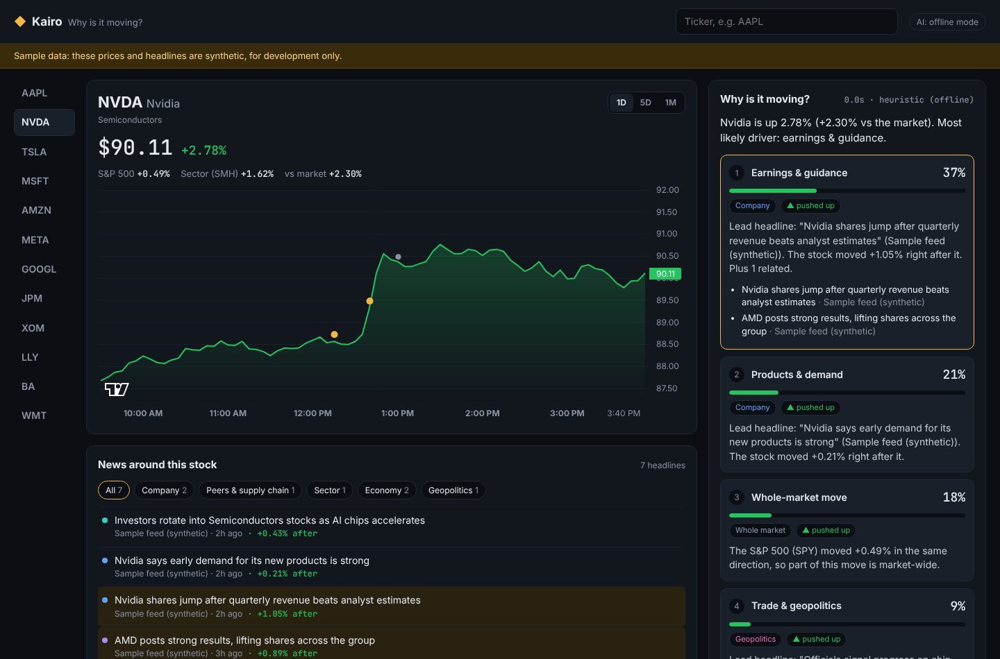

# Kairo — why is this stock moving?

Pick a US stock and Kairo tells you, in a couple of seconds, the most likely reasons
it's moving: company news, competitors and suppliers, its sector, the economy and
geopolitics. Each reason gets a likelihood and links to the headlines behind it.

The name comes from the Greek *kairos*, "the decisive moment".

Built for the Sea x OpenAI Codex Hackathon, Kuala Lumpur (5 Dec 2026).



## How it works

1. **Prices**: the stock, the S&P 500 (SPY) and its sector ETF, so we can tell a
   stock-specific move from the whole market moving.
2. **News in five groups**: company, peers & supply chain, sector, economy, geopolitics
   (`backend/app/universe.py` lists what each stock is connected to).
3. **Price reaction per headline**: for each headline we measure how the stock moved in
   the ~30 minutes right after it (a mini event study). This gives the AI timing
   evidence, not just text.
4. **AI ranking**: an OpenAI model ranks the likely reasons, with likelihoods that add up
   to 100% (including "not explained by the news"), and cites the headlines it used.
   Without an OpenAI key, a simpler offline analyzer runs instead.

Prices and headlines are streamed to the screen first, then the AI's answer.

## Run it

You need Python 3.11+ and Node 18+.

```bash
# Backend
cd backend
python3 -m venv ../.venv && ../.venv/bin/pip install -r requirements.txt
cp .env.example .env          # then paste your keys into .env (see below)
../.venv/bin/uvicorn app.main:app --reload --port 8000

# Frontend (second terminal)
cd frontend
npm install
npm run dev                   # open http://localhost:5173
```

No keys yet? Set `DATA_MODE=sample` in `backend/.env`. The app then runs fully offline on
**synthetic sample data**, clearly marked with a yellow banner. Use it for development
only, never as real market information.

Single server for demos: run `npm run build` in `frontend/`, and the backend serves the
app at http://localhost:8000.

Tests: `cd backend && ../.venv/bin/python -m pytest`

## Getting the API keys

| Key | Where | Cost |
| --- | --- | --- |
| `OPENAI_API_KEY` | platform.openai.com → sign in → **Settings → Billing** (add a little credit) → **API keys → Create new secret key** | Pay as you go; a few cents per hundred explanations with a small model |
| `FINNHUB_API_KEY` | finnhub.io/register → the key is on your dashboard | Free tier (60 requests/min) |

Paste them into `backend/.env`. Never commit that file (it's in `.gitignore`) and never
share keys in chat. OpenAI's terms have age rules, so have a team member who is 18+ own
the account and billing.

Google News and Yahoo Finance need no key.

## Before selling it

The free data sources here are fine for a prototype and a demo, but not for a paid
product:

- **Market data**: Yahoo's chart endpoint is unofficial. Switch to a licensed feed
  (e.g. Polygon, Alpaca, Databento).
- **News**: use a licensed real-time feed (e.g. Benzinga, Finnhub paid) for speed and
  redistribution rights.
- **Positioning**: Kairo explains moves; it does not give buy/sell advice. Keep it
  that way unless you get proper regulatory advice.
- **Calibration**: check that "70% likely" reasons are right about 70% of the time, by
  replaying past moves where the cause is known.

## Project layout

```
backend/app/
  main.py               API: /api/stream/{ticker} (SSE), /api/explain, /api/context
  context.py            gathers prices + news in parallel, price reactions, cache
  universe.py           what each stock is connected to
  providers/            prices (Yahoo), news (Finnhub, Google News, Yahoo RSS), sample data
  analyzer/             OpenAI analyzer, offline fallback, engine that picks one
frontend/src/
  App.tsx               layout, ticker search, streaming
  components/           PriceChart, WhyPanel, NewsFeed
```

*Explains likely reasons for past price moves from public news. Not investment advice.*
